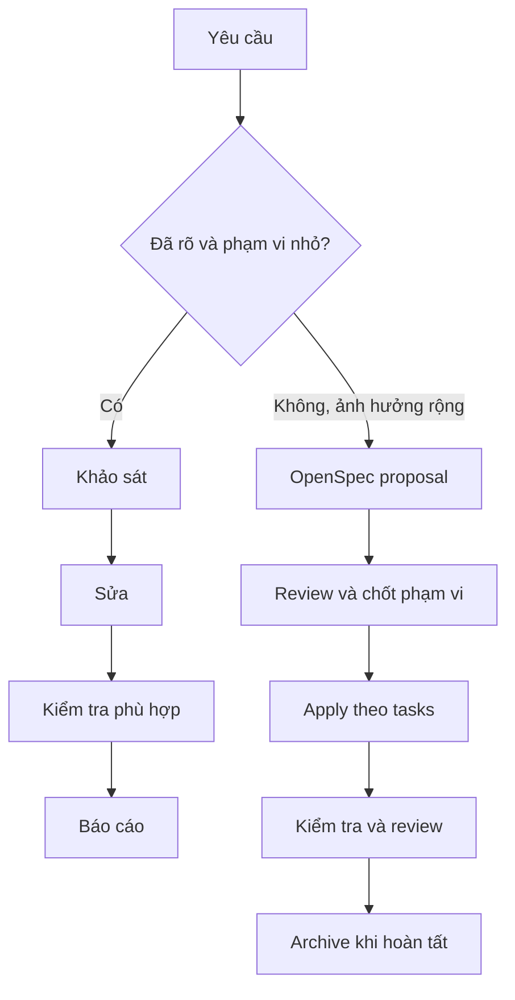

# Quy trình dùng AI khi phát triển StudyHub

Tài liệu này thống nhất cách giao việc, triển khai và review code với Codex, Claude Code hoặc AI coding assistant khác.

## 1. Bối cảnh dự án

- `app-user`, `app-admin`: ứng dụng Android viết bằng Kotlin.
- `backend`: Kotlin Android library, phụ trách truy cập Supabase; hiện không phải Java/Spring Boot backend.
- Build dùng Gradle Kotlin DSL. Trước khi sửa build, kiểm tra version catalog, module và phiên bản toolchain hiện có.
- Supabase RLS mới là ranh giới phân quyền dữ liệu. Kiểm tra phía UI không thay thế authorization.
- Đọc `AGENTS.md`, `PROJECT_STRUCTURE.md` và skill phù hợp trong `.codex/skills/` trước khi giao việc.

## 2. Chọn luồng

| Yêu cầu | Luồng phù hợp |
| --- | --- |
| Hỏi đáp hoặc giải thích code | AI khảo sát phần liên quan, trả lời kèm file/vị trí và bằng chứng. |
| Sửa nhỏ, phạm vi rõ, ít rủi ro | Khảo sát → sửa → kiểm tra phù hợp → báo cáo. |
| Tính năng mới hoặc thay đổi nhiều module, nghiệp vụ, API, schema hay kiến trúc | OpenSpec: proposal → review → apply → kiểm tra → archive. |
| Lỗi khó tìm nguyên nhân | Tái hiện → thu thập log/thông tin → xác định nguyên nhân → sửa → kiểm tra lại. |
| Bảo mật, RLS, credential hoặc dữ liệu người dùng | Phân tích tác động và chính sách trước; người phụ trách xác nhận quyết định nhạy cảm. |

Không cần tạo OpenSpec cho câu hỏi và thay đổi nhỏ. Dùng OpenSpec khi nhóm cần duyệt trước yêu cầu, quyết định thiết kế và tiêu chí nghiệm thu.



## 3. Luồng chuẩn cho mọi thay đổi

### Bước 1 — Hiểu yêu cầu và code hiện tại

AI cần xác định mục tiêu, module chịu ảnh hưởng, hành vi hiện tại và tiêu chí chấp nhận. Đọc code lân cận, cấu hình và tài liệu liên quan trước khi đề xuất giải pháp. Nêu giả định nếu còn thiếu dữ kiện.

### Bước 2 — Chọn phạm vi và cách làm

Với việc nhỏ, ghi kế hoạch ngắn và tiến hành trong phạm vi yêu cầu. Với việc lớn, có nhiều lựa chọn thiết kế hoặc thay đổi dữ liệu/API, lập OpenSpec proposal để review trước khi viết code.

### Bước 3 — Thực hiện theo lát nhỏ

Sửa từng phần có thể review độc lập. Theo kiến trúc hiện có: UI gọi ViewModel/repository; truy cập Supabase nằm trong `backend`. Không thêm framework, dependency hoặc thay đổi contract nếu không cần thiết cho yêu cầu.

### Bước 4 — Kiểm tra kết quả

Chọn kiểm tra theo loại thay đổi: đọc diff, compile/build, unit test, kiểm thử UI hoặc xác nhận schema/RLS. Chỉ báo các lệnh thực sự đã chạy và kết quả thật. Nếu môi trường, thiết bị, credential hoặc dịch vụ ngoài không sẵn sàng, ghi rõ phần chưa kiểm chứng.

### Bước 5 — Review và bàn giao

Tóm tắt mục tiêu đã xử lý, file quan trọng đã sửa, quyết định đáng chú ý, kiểm tra đã chạy và việc còn lại. Kiểm tra diff để phát hiện thay đổi ngoài phạm vi, secret, dữ liệu nhạy cảm hoặc dependency phát sinh ngoài ý muốn.

## 4. Luồng OpenSpec

### Điều kiện bắt đầu

Repo đã có `openspec/config.yaml`, canonical specs và lịch sử change trong `openspec/`. Kiểm tra CLI bằng `openspec.cmd --version` trên Windows và dùng cấu hình hiện có; không khởi tạo lại chỉ vì một workflow cũ nhắc đến `openspec/project.md` hoặc `openspec/AGENTS.md`.

Với agent Gemini trong Android Studio, đọc [hướng dẫn cấu hình Gemini](.gemini/README.md). Rules được nạp qua `GEMINI.md` ở root; skills nằm trong `.android-studio/skills/` và có thể chọn bằng `@`. `.gemini/commands/opsx/` dành cho Gemini CLI, không tự đăng ký slash command trong Android Studio. Sau khi cập nhật skills, chạy `python .gemini/scripts/sync_skills.py` và `python .gemini/scripts/sync_skills.py --check`.

### A. Proposal — ghi yêu cầu, chưa sửa code

1. Khảo sát yêu cầu, code, tài liệu và spec hiện có.
2. Tạo change ID duy nhất, dễ hiểu.
3. Viết `proposal.md` cho vấn đề, mục tiêu, phạm vi và kết quả mong muốn.
4. Viết `design.md` khi có quyết định kiến trúc, rủi ro hoặc phương án cần so sánh.
5. Viết spec delta cho từng capability bị ảnh hưởng. Requirement cần có scenario WHEN/THEN cụ thể.
6. Chia `tasks.md` thành task nhỏ, có tiêu chí hoàn tất và cách kiểm chứng.
7. Chạy `openspec validate <change-id> --strict --no-interactive` nếu CLI và cấu trúc repo đã sẵn sàng.
8. Người yêu cầu/reviewer chốt phạm vi, tiêu chí nghiệm thu và quyết định về dữ liệu/bảo mật trước khi apply.

### B. Apply — triển khai proposal đã duyệt

1. Đọc lại proposal, design, spec delta và tasks.
2. Làm theo thứ tự dependency; cập nhật trạng thái task đúng thực tế.
3. Với logic nghiệp vụ/data access, viết hoặc cập nhật kiểm tra cho contract và trường hợp lỗi. Với UI/config, chọn kiểm chứng phù hợp như build, preview hoặc smoke check.
4. Khi đổi Supabase, xác nhận model/query tương thích schema và không bỏ qua yêu cầu RLS.
5. Cập nhật tài liệu triển khai/summary nếu quy trình của change yêu cầu.
6. Review diff, chạy kiểm tra phù hợp và đối chiếu hành vi với scenario trong spec.

### C. Archive — đóng change đã hoàn tất

Chỉ archive khi implementation đã review và change đủ điều kiện đóng theo quy trình nhóm. Xác nhận đúng change ID, task status, summary và spec delta; chạy lệnh archive theo phiên bản OpenSpec đang dùng; sau đó kiểm tra canonical specs và vị trí archive. Không archive change còn task dang dở hoặc chưa khớp hành vi thực tế.

## 5. Mẫu giao việc cho AI

```text
Mục tiêu:
[Người dùng cần làm được gì?]

Phạm vi:
[Module, màn hình, dữ liệu hoặc luồng liên quan]

Yêu cầu và ràng buộc:
[Hành vi, trường hợp lỗi, kiến trúc cần giữ, giới hạn không được đổi]

Tiêu chí hoàn tất:
[Cách biết thay đổi đã đáp ứng yêu cầu]

Hãy đọc AGENTS.md, PROJECT_STRUCTURE.md và code liên quan trước.
Nếu phạm vi nhỏ, thực hiện trực tiếp. Nếu thay đổi rộng hoặc có quyết định
nghiệp vụ/kiến trúc, đề xuất OpenSpec trước. Khi bàn giao, nêu file đã đổi,
kiểm tra thực sự đã chạy và phần chưa kiểm chứng.
```

### Ví dụ

```text
Thêm trạng thái loading, lỗi và thử lại cho danh sách bài viết trong app-user.
Giữ truy cập Supabase trong backend và dùng pattern UI hiện tại.
Đọc code liên quan trước; không thay đổi dependency.
Sau khi sửa, báo file đã đổi và kiểm tra phù hợp đã chạy.
```

## 6. An toàn và chất lượng

- Không đưa credential, service-role key, dữ liệu cá nhân thật hoặc dữ liệu production nhạy cảm vào prompt.
- Không tự chạy migration lên production, deploy, xóa dữ liệu hoặc gọi dịch vụ bên ngoài nếu chưa được giao rõ.
- Với thay đổi authorization/RLS, xác nhận chính sách phía server; không dựa vào việc ẩn nút hay validate trên app.
- Không để AI tự khẳng định “đã pass” khi chưa chạy kiểm tra tương ứng.
- Người review chịu trách nhiệm cuối cùng về correctness, privacy, security và quyết định phát hành.
