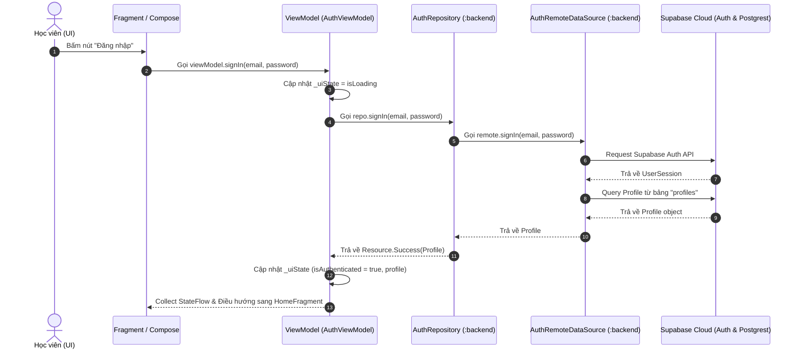

# 📁 CHI TIẾT CÂY THƯ MỤC & CẤU TRÚC DỰ ÁN STUDYHUB

Tài liệu này mô tả **chi tiết toàn bộ cây thư mục**, vai trò từng file, package, module và luồng kiến trúc trong đồ án **StudyHub** (Mạng xã hội học tập di động).

---

## 📑 MỤC LỤC
1. [Tổng Quan Kiến Trúc Multi-Module](#1-tổng-quan-kiến-trúc-multi-module)
2. [Cây Thư Mục Toàn Cục Dự Án (Global Tree)](#2-cây-thư-mục-toàn-cục-dự-án-global-tree)
3. [Chi Tiết Cấu Trúc Cấp Gốc (Root Level)](#3-chi-tiết-cấu-trúc-cấp-gốc-root-level)
4. [Chi Tiết Module `:backend` (Shared Data & API Layer)](#4-chi-tiết-module-backend-shared-data--api-layer)
5. [Chi Tiết Module `:app-user` (Frontend Học Viên)](#5-chi-tiết-module-app-user-frontend-học-viên)
6. [Chi Tiết Module `:app-admin` (Frontend Quản Trị Viên)](#6-chi-tiết-module-app-admin-frontend-quản-trị-viên)
7. [Mô Hình Luồng Dữ Liệu (Data Flow Architecture)](#7-mô-hình-luồng-dữ-liệu-data-flow-architecture)
8. [Hướng Dẫn Thêm Chức Năng Mới Vào Thư Mục Chuẩn](#8-hướng-dẫn-thêm-chức-năng-mới-vào-thư-mục-chuẩn)

---

## 1. TỔNG QUAN KIẾN TRÚC MULTI-MODULE

Dự án StudyHub áp dụng **Kiến trúc Multi-module (3 Modules)** giúp phân tách rõ ràng trách nhiệm giữa Frontend và Backend Data Layer:

```text
StudyHub (Root)
├── 📱 :app-user   (Giao diện di động dành cho Học viên / Sinh viên)
├── 🛡️ :app-admin  (Giao diện di động dành cho Admin Quản trị hệ thống)
└── 💾 :backend    (Module dữ liệu dùng chung, kết nối Supabase Cloud)
```

### 💡 Vai trò chính:
- **`:app-user`**: Chứa toàn bộ giao diện, Fragment, XML Layout, Navigation Graph và ViewModel phục vụ trải nghiệm người dùng học viên.
- **`:app-admin`**: Chứa giao diện và ViewModel quản lý hệ thống dành riêng cho Administrator (quản lý user, duyệt báo cáo, môn học).
- **`:backend`**: Module Android Library chứa `SupabaseClient`, Model Dữ liệu (`@Serializable`), Data Source (`Postgrest`, `Auth`), Repository đóng gói dữ liệu dạng `Resource<T>` dùng chung cho cả 2 app trên.

---

## 2. CÂY THƯ MỤC TOÀN CỤC DỰ ÁN (GLOBAL TREE)

```text
StudyHub/
├── .github/                      # Cấu hình GitHub Actions CI/CD (nếu có)
├── gradle/                       # Gradle Wrapper & Version Catalog
│   ├── wrapper/
│   │   ├── gradle-wrapper.jar
│   │   └── gradle-wrapper.properties
│   └── libs.versions.toml        # 📌 Version Catalog (Quản lý tập trung dependencies & plugins)
├── app-user/                     # 📱 Module Frontend App Học viên
│   ├── build.gradle.kts          # Cấu hình build & dependencies cho app-user
│   └── src/
│       └── main/
│           ├── AndroidManifest.xml
│           ├── java/com/doan/studyhub/user/
│           │   ├── MainActivity.kt
│           │   ├── di/           # Dependency Injection setup
│           │   └── ui/           # Feature UI packages (auth, home, post, group...)
│           └── res/              # Tài nguyên giao diện XML, Drawables, Navigation Graph
├── app-admin/                    # 🛡️ Module Frontend App Admin
│   ├── build.gradle.kts          # Cấu hình build & dependencies cho app-admin
│   └── src/
│       └── main/
│           ├── AndroidManifest.xml
│           ├── java/com/doan/studyhub/admin/
│           │   ├── MainActivity.kt
│           │   ├── di/
│           │   └── ui/           # Feature UI packages (auth, dashboard, users, reports...)
│           └── res/              # Tài nguyên giao diện Admin
├── backend/                      # 💾 Module Data & API Layer dùng chung
│   ├── build.gradle.kts          # Cấu hình build, Supabase BOM, Ktor & BuildConfig
│   └── src/
│       └── main/
│           ├── AndroidManifest.xml
│           └── java/com/doan/studyhub/
│               ├── common/       # Utility dùng chung (Resource.kt)
│               └── core/data/    # Tầng kết nối dữ liệu Supabase
│                   ├── SupabaseClient.kt
│                   ├── model/    # Data models (@Serializable)
│                   ├── remote/   # Remote Data Sources (Supabase Auth/Postgrest)
│                   └── repository/# Business Repositories (AuthRepository...)
├── build.gradle.kts              # Top-level Gradle build script
├── settings.gradle.kts           # Khai báo các subprojects (:app-user, :app-admin, :backend)
├── gradle.properties             # Cấu hình biến môi trường build JVM & AndroidX
├── local.properties              # Lưu trữ bí mật (SUPABASE_URL, SUPABASE_ANON_KEY) - GitIgnored
├── README.md                     # Tài liệu tổng quan dự án, WBS & ERD
└── PROJECT_DIRECTORY_TREES.md    # 📄 File hướng dẫn chi tiết cây thư mục này
```

---

## 3. CHI TIẾT CẤU TRÚC CẤP GỐC (ROOT LEVEL)

| Tên File / Thư mục | Vai trò & Giải thích |
| :--- | :--- |
| `build.gradle.kts` | File cấu hình Gradle cấp cao nhất (Top-level). Nơi khai báo các Gradle Plugin chung như `android.application`, `android.library`, `kotlin.compose`, `kotlin.serialization` với thuộc tính `apply false`. |
| `settings.gradle.kts` | File quản lý danh sách các module thuộc dự án qua lệnh `include(":app-user")`, `include(":app-admin")`, `include(":backend")`. Cấu hình nguồn tải thư viện Maven/Google và Gradle Plugin Management. |
| `gradle/libs.versions.toml` | **Version Catalog**: File cấu hình tập trung lưu trữ phiên bản thư viện (Compose BOM `2026.02.01`, Supabase `3.1.4`, Ktor `3.1.1`, Kotlin `2.2.10`, Navigation `2.8.8`...). |
| `gradle.properties` | Chứa tham số cấu hình bộ nhớ JVM, bật AndroidX (`android.useAndroidX=true`), cấu hình cho Kotlin Daemon. |
| `local.properties` | File cá nhân chứa đường dẫn Android SDK và các khóa bí mật (`SUPABASE_URL`, `SUPABASE_ANON_KEY`). **Lưu ý:** File này nằm trong `.gitignore`, tuyệt đối không commit lên Github. |
| `README.md` | Tài liệu chính giới thiệu dự án, công nghệ sử dụng, cấu trúc cơ sở dữ liệu (17 bảng PostgreSQL), sơ đồ ERD và bảng phân giải công việc WBS. |
| `PROJECT_DIRECTORY_TREES.md` | Tài liệu diễn giải chi tiết cây thư mục dự án này. |

---

## 4. CHI TIẾT MODULE `:backend` (SHARED DATA & API LAYER)

Module `:backend` là trái tim xử lý dữ liệu di động, dùng chung cho cả `app-user` và `app-admin`.

### 📂 Cây thư mục module `:backend`:
```text
backend/
├── build.gradle.kts              # Tích hợp Supabase BOM, Ktor Client, Serialization & BuildConfig
└── src/
    └── main/
        ├── AndroidManifest.xml   # Manifest khai báo module Android Library
        └── java/com/doan/studyhub/
            ├── common/
            │   └── Resource.kt   # Lớp bọc trạng thái dữ liệu (Loading, Success, Error)
            └── core/data/
                ├── SupabaseClient.kt    # Singleton kết nối Supabase Cloud
                ├── model/
                │   └── Profile.kt       # Data Class bảng "profiles" (@Serializable)
                ├── remote/
                │   └── AuthRemoteDataSource.kt  # Gọi trực tiếp API Supabase Auth & Postgrest
                └── repository/
                    └── AuthRepository.kt        # Xử lý logic nghiệp vụ, bắt lỗi & trả về Resource<T>
```

### 📝 Chi tiết chức năng từng file trong `:backend`:

1. **`build.gradle.kts`**:
   - Đọc `SUPABASE_URL` và `SUPABASE_ANON_KEY` từ `local.properties` để inject vào class `BuildConfig`.
   - Khai báo dependency: `supabase.bom`, `supabase.postgrest`, `supabase.auth`, `ktor.client.android`, `kotlinx.serialization.json`.

2. **`common/Resource.kt`**:
   - Định nghĩa `sealed class Resource<out T>` hỗ trợ truyền trạng thái từ Repository lên UI:
     - `Resource.Loading`: Đang xử lý bất đồng bộ.
     - `Resource.Success(val data: T)`: Xử lý thành công và trả về dữ liệu `data`.
     - `Resource.Error(val message: String, val cause: Throwable?)`: Thất bại, chứa câu thông báo lỗi đã được việt hóa.

3. **`core/data/SupabaseClient.kt`**:
   - Khởi tạo đối tượng Singleton `SupabaseClient` bằng `createSupabaseClient`.
   - Cài đặt 2 plugin cốt lõi: `Auth` (xác thực người dùng) và `Postgrest` (thao tác CSDL PostgreSQL).

4. **`core/data/model/Profile.kt`**:
   - Class `@Serializable` đại diện cho một bản ghi trong bảng `profiles` trên CSDL Supabase.
   - Các thuộc tính: `id`, `username`, `displayName`, `avatarUrl`, `bio`, `role` (`user`/`admin`), `isBanned`, `createdAt`.

5. **`core/data/remote/AuthRemoteDataSource.kt`**:
   - Tầng tương tác trực tiếp với SDK Supabase.
   - Hàm `signUp(...)`: Đăng ký tài khoản Supabase Auth, tự động khởi tạo dòng dữ liệu ban đầu vào bảng `profiles`.
   - Hàm `signIn(...)`: Đăng nhập với Email & Password.
   - Các hàm phụ trợ: `signOut()`, `sendPasswordResetEmail()`, `updatePassword()`, `getCurrentSession()`, `getProfile()`.

6. **`core/data/repository/AuthRepository.kt`**:
   - Tầng Repository đóng gói luồng xử lý trên `Dispatchers.IO`.
   - Bắt các ngoại lệ mạng/API và việt hóa thông báo lỗi thân thiện qua hàm `parseError()`.
   - Kiểm tra trạng thái tài khoản bị khóa (`isBanned == true`), tự động đăng xuất nếu bị cấm.

---

## 5. CHI TIẾT MODULE `:app-user` (FRONTEND HỌC VIÊN)

Module `:app-user` cung cấp toàn bộ trải nghiệm người dùng học viên trên di động.

### 📂 Cây thư mục module `:app-user`:
```text
app-user/
├── build.gradle.kts              # Khai báo dependency :backend, Jetpack Compose, Navigation Component, ViewBinding
└── src/
    └── main/
        ├── AndroidManifest.xml   # Khai báo MainActivity, Application name, Theme & Permissions
        ├── java/com/doan/studyhub/user/
        │   ├── MainActivity.kt   # Single Activity chứa NavHostFragment
        │   ├── di/               # Hỗ trợ cấu hình Dependency Injection
        │   └── ui/               # Phân chia mã nguồn theo từng Feature Package
        │       ├── auth/         # Phân hệ Xác thực & Tài khoản
        │       │   ├── AuthUiState.kt      # Data class lưu trữ trạng thái giao diện Auth
        │       │   ├── AuthViewModel.kt    # ViewModel điều phối luồng Auth
        │       │   ├── SignIn.kt           # Fragment Đăng nhập
        │       │   ├── SignUp.kt           # Fragment Đăng ký
        │       │   └── ForgotPassword.kt   # Fragment Quên mật khẩu
        │       ├── home/
        │       │   └── Home.kt             # Fragment Trang chủ & Hamburger Drawer Navigation
        │       ├── feed/
        │       │   └── Feed.kt             # Màn hình Bảng tin & Khám phá bài viết
        │       ├── subject/
        │       │   └── Subject.kt          # Màn hình Môn học & Tài liệu
        │       ├── post/
        │       │   └── Post.kt             # Màn hình Đăng bài viết / Hỏi đáp
        │       ├── group/
        │       │   └── Group.kt            # Màn hình Nhóm học tập
        │       ├── friend/
        │       │   └── Friend.kt           # Màn hình Quản lý bạn bè
        │       ├── chat/
        │       │   └── Chat.kt             # Màn hình Nhắn tin Realtime
        │       ├── notification/
        │       │   └── Notification.kt     # Màn hình Thông báo hệ thống
        │       ├── profile/
        │       │   └── Profile.kt          # Màn hình Trang cá nhân học viên
        │       ├── settings/
        │       │   └── Settings.kt         # Màn hình Cài đặt ứng dụng
        │       └── interaction/            # Màn hình/Component tương tác (Like, Comment...)
        └── res/
            ├── drawable/         # Custom Background XML, Icons & Logos
            │   ├── bg_avatar_circle.xml
            │   ├── bg_banner_card.xml
            │   ├── bg_drawer_header.xml
            │   ├── bg_drawer_item_selected.xml
            │   ├── bg_drawer_logout.xml
            │   ├── bg_error_box.xml
            │   ├── bg_streak_pill.xml
            │   ├── bg_success_box.xml
            │   ├── bg_urgent_pill.xml
            │   ├── ic_assignment.xml, ic_book.xml, ic_calendar.xml, ic_email.xml...
            │   └── logo1.png, logo2.png
            ├── layout/           # File thiết kế giao diện XML
            │   ├── activity_main.xml
            │   ├── sign_in.xml
            │   ├── sign_up.xml
            │   ├── forgot_password.xml
            │   ├── home.xml
            │   ├── fragment_feed.xml
            │   ├── fragment_subject.xml
            │   ├── fragment_post.xml
            │   ├── fragment_group.xml
            │   ├── fragment_friend.xml
            │   ├── fragment_chat.xml
            │   ├── fragment_notification.xml
            │   ├── fragment_profile.xml
            │   └── fragment_settings.xml
            ├── navigation/
            │   └── nav_graph.xml # Sơ đồ luồng chuyển màn hình Jetpack Navigation
            └── values/
                ├── colors.xml    # Mã màu chủ đạo (Primary, Secondary, Background...)
                └── themes.xml    # Cấu hình Theme Android (Material3)
```

### 📝 Chi tiết mã nguồn chính trong `:app-user`:

- **`MainActivity.kt`**: Activity duy nhất theo mô hình Single-Activity Architecture, chứa Container `NavHostFragment`.
- **`ui/auth/AuthViewModel.kt`**: ViewModel phạm vi Activity (`activityViewModels()`) dùng chung dữ liệu xác thực cho `SignIn`, `SignUp`, `ForgotPassword`. Sử dụng `StateFlow<AuthUiState>` đẩy trạng thái phản hồi realtime cho UI.
- **`ui/auth/SignIn.kt`**: Đăng nhập qua Email/Password, lắng nghe `AuthUiState.isAuthenticated` để chuyển hướng tự động sang `Home`.
- **`ui/auth/SignUp.kt`**: Đăng ký người dùng mới với các trường thông tin: Email, Display Name, Username, Mật khẩu & Nhập lại mật khẩu.
- **`ui/home/Home.kt`**: Fragment trang chủ chứa Navigation Drawer (Menu 3 gạch), điều phối thay thế các Fragment tính năng (`Feed`, `Subject`, `Post`, `Group`, `Friend`, `Chat`, `Notification`, `Settings`, `Profile`) vào `containerMain`.
- **`res/navigation/nav_graph.xml`**: Khai báo các màn hình chính và hướng chuyển trang (`action_signIn_to_signUp`, `action_signIn_to_main`, `action_main_to_signIn`...).

---

## 6. CHI TIẾT MODULE `:app-admin` (FRONTEND QUẢN TRỊ VIÊN)

Module `:app-admin` cung cấp công cụ quản trị hệ thống cho Admin.

### 📂 Cây thư mục module `:app-admin`:
```text
app-admin/
├── build.gradle.kts              # Khai báo dependency :backend, Jetpack Compose, Material3
└── src/
    └── main/
        ├── AndroidManifest.xml   # Cấu hình cho App Admin
        ├── java/com/doan/studyhub/admin/
        │   ├── MainActivity.kt   # Container chính cho phân hệ Admin
        │   ├── di/               # DI setup cho Admin
        │   └── ui/
        │       ├── auth/         # Đăng nhập dành riêng cho Admin
        │       ├── dashboard/    # Bảng điều khiển & thống kê tổng quan
        │       ├── users/        # Quản lý danh sách học viên & Khóa tài khoản
        │       ├── subjects/     # Thêm/Sửa/Xóa danh mục môn học
        │       └── reports/      # Xử lý báo cáo vi phạm nội dung/người dùng
        └── res/
            ├── drawable/         # Logo & Tài nguyên giao diện Admin
            └── values/
                └── themes.xml    # Theme riêng cho Admin
```

---

## 7. MÔ HÌNH LUỒNG DỮ LIỆU (DATA FLOW ARCHITECTURE)

Dự án StudyHub tuân thủ chặt chẽ kiến trúc **Unidirectional Data Flow (UDF)**:



---

## 8. HƯỚNG DẪN THÊM CHỨC NĂNG MỚI VÀO THƯ MỤC CHUẨN

Khi bạn được phân công làm một chức năng mới (Ví dụ: *Quản lý Bài viết - Post*):

1. **Bước 1: Tạo Data Model (trong Module `:backend`)**
   - Thêm Data class mới trong `backend/src/main/java/com/doan/studyhub/core/data/model/Post.kt`.
   - Đánh dấu thẻ `@Serializable` và `@SerialName` khớp với tên cột CSDL PostgreSQL.

2. **Bước 2: Tạo Remote Data Source & Repository (trong Module `:backend`)**
   - Thêm hàm truy vấn Supabase trong `backend/src/main/java/com/doan/studyhub/core/data/remote/PostRemoteDataSource.kt`.
   - Tạo Repository tương ứng trong `backend/src/main/java/com/doan/studyhub/core/data/repository/PostRepository.kt` trả về `Resource<List<Post>>`.

3. **Bước 3: Thiết kế Giao diện UI (trong Module `:app-user` hoặc `:app-admin`)**
   - Tạo file XML Layout trong `app-user/src/main/res/layout/fragment_post_detail.xml`.
   - Đăng ký destination mới trong `app-user/src/main/res/navigation/nav_graph.xml`.

4. **Bước 4: Viết Fragment & ViewModel (trong Module `:app-user`)**
   - Tạo Package `app-user/src/main/java/com/doan/studyhub/user/ui/post/`.
   - Viết `PostViewModel.kt` quản lý StateFlow và `PostDetailFragment.kt` hiển thị dữ liệu.
