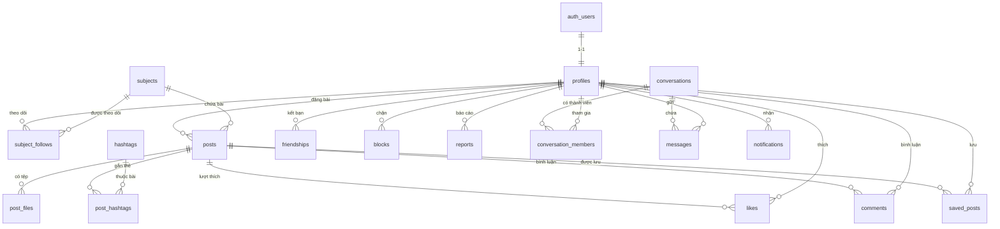

# 🎓 StudyHub - Mạng Xã Hội Học Tập Trên Nền Tảng Di Động

**StudyHub** là ứng dụng mạng xã hội học tập dành riêng cho học sinh, sinh viên trên nền tảng Android. Ứng dụng giúp người dùng kết nối bạn bè, theo dõi các môn học, chia sẻ tài liệu/bài viết, hỏi đáp kiến thức và thảo luận nhóm trực tiếp theo thời gian thực (Realtime).

---

## 🛠️ Công Nghệ Sử Dụng

| Thành phần | Công nghệ / Thư viện | Mô tả |
| :--- | :--- | :--- |
| **Nền tảng** | Android (Kotlin) | Kiến trúc Multi-module (`:app-user`, `:app-admin`, `:backend`). |
| **Giao diện (UI)** | ViewBinding (XML) & Jetpack Compose | Kết hợp linh hoạt ViewBinding XML và Jetpack Compose. |
| **Backend & SDK** | Supabase (`supabase-kt` BOM) | Kotlin SDK chính thức cho Supabase. |
| **Xác thực (Auth)** | Supabase Auth | Đăng ký, Đăng nhập (Email/Password), Quản lý phiên & Khôi phục mật khẩu. |
| **Cơ sở dữ liệu** | Supabase Database (PostgreSQL) | 17 bảng dữ liệu, cấu hình Row Level Security (RLS) để phân quyền dữ liệu & Admin. |
| **Lưu trữ tệp** | Supabase Storage | Lưu trữ Avatar, Ảnh bài viết, Tệp tài liệu (PDF, DOCX...) & Media chat (`avatars`, `post-images`, `documents`, `chat-media`). |
| **Thời gian thực** | Supabase Realtime | Tin nhắn tức thì, Thông báo In-app, Trạng thái online/đang nhập (Presence). |
| **Xử lý bất đồng bộ** | Kotlin Coroutines & Flow | Quản lý luồng dữ liệu bất đồng bộ & StateFlow cho UI State. |

---

## 📌 Quy Ước & Thiết Kế Kiến Trúc Cốt Lõi

* **Cấu trúc Multi-module:**
  * `:app-user`: Ứng dụng dành cho người dùng học sinh / sinh viên.
  * `:app-admin`: Phân hệ dành riêng cho Admin quản trị hệ thống.
  * `:backend`: Module chứa `SupabaseClient`, Model, Repository & Data Source dùng chung.
* **Mức ưu tiên tính năng (WBS):**
  * **P1 (MVP - Bắt buộc):** Luồng chính gồm Đăng ký/Đăng nhập, Đăng bài/Tài liệu, Kết bạn, Xem bảng tin, Tương tác (Like/Comment), Chat 1-1 Realtime, Thông báo.
  * **P2 (Nên có):** Nhóm học tập, Quản trị Admin, Hỏi đáp đánh dấu câu trả lời đúng, Lưu bài viết, Khám phá, Hashtag, Chặn người dùng, Dark mode.
  * **P3 (Mở rộng):** Báo cáo nội dung, Lịch sử tìm kiếm, Họp trực tuyến (Jitsi Meet link), Trạng thái hoạt động Presence.
* **Quy ước hệ thống:**
  * **Kết bạn hai chiều:** Không dùng cơ chế Follow người dùng (Theo dõi chỉ dành cho Môn học). Chỉ bạn bè mới có thể nhắn tin 1-1 và thêm vào nhóm học tập.
  * **Bài viết 3 loại:** Tất cả nội dung (*Kiến thức*, *Hỏi đáp*, *Tài liệu*) dùng chung 1 luồng đăng bài, phân biệt qua thuộc tính `type`.
  * **Hệ thống Chat tái sử dụng:** Chat 1-1 và Chat nhóm dùng chung cấu trúc bảng `conversations`, `conversation_members`, và `messages`.
  * **Admin tích hợp:** Admin dùng chung app di động, phân quyền trực tiếp qua `profiles.role = 'admin'` và kiểm soát bằng Supabase RLS.

---

## 🗄️ Cấu Trúc Cơ Sở Dữ Liệu (17 Bảng PostgreSQL)

Hệ thống bao gồm 17 bảng dữ liệu được chuẩn hóa và quản lý bằng Supabase RLS:

| STT | Tên bảng | Phân hệ WBS | Mô tả chức năng |
| :---: | :--- | :--- | :--- |
| 1 | `profiles` | 1, 2, 12 | Thông tin người dùng (liên kết `auth.users`), chứa `role` (user/admin) & `is_banned`. |
| 2 | `subjects` | 3, 12.3 | Danh sách môn học (do Admin quản lý). |
| 3 | `subject_follows` | 3.2 | Người dùng theo dõi môn học. |
| 4 | `posts` | 4, 6.5 | Bài viết (loại bài: `knowledge`, `question`, `document`), chứa `best_comment_id`. |
| 5 | `post_files` | 4.1, 4.2 | Tệp hình ảnh hoặc tài liệu đính kèm bài viết. |
| 6 | `hashtags` | 4.7 | Thẻ hashtag bài viết. |
| 7 | `post_hashtags` | 4.7 | Bảng trung gian n-n giữa Bài viết và Hashtags. |
| 8 | `likes` | 6.1, 6.4 | Lượt thích bài viết. |
| 9 | `comments` | 6.2, 6.3, 6.5 | Bình luận bài viết, hỗ trợ `parent_id` (1 cấp) & `is_best_answer`. |
| 10 | `saved_posts` | 4.6 | Bài viết người dùng đã lưu. |
| 11 | `friendships` | 7.1, 7.2 | Quan hệ kết bạn (`pending` / `accepted`). |
| 12 | `blocks` | 7.6 | Danh sách người dùng bị chặn. |
| 13 | `reports` | 6.7, 12.4 | Báo cáo vi phạm (bài viết, bình luận, người dùng). |
| 14 | `conversations` | 8, 9 | Cuộc trò chuyện (`direct` / `group`). |
| 15 | `conversation_members` | 8, 9.2, 9.4 | Thành viên trò chuyện (`admin` / `member`) & `last_read_at`. |
| 16 | `messages` | 8.2, 8.5, 9.3 | Tin nhắn (`text`, `image`, `file`) & trạng thái (`sending`, `sent`, `seen`). |
| 17 | `notifications` | 10 | Thông báo In-app (like, comment, friend request, best answer...). |

### 📊 Sơ đồ thực thể liên kết (ERD)



---

## 🗺️ Phân Giải Chức Năng Chi Tiết (WBS - 12 Phân Hệ)

### 1. Xác thực & Tài khoản (Authentication) - `P1`
* **1.1 Đăng ký:** Email, Mật khẩu (≥8 ký tự), Tên hiển thị, tự động tạo `profiles`.
* **1.2 Đăng nhập:** Email/Password, lưu phiên đăng nhập, kiểm tra trạng thái bị khóa (`is_banned`).
* **1.3 Quên mật khẩu & 1.4 Đăng xuất:** Khôi phục qua Email, xóa session.

### 2. Hồ sơ người dùng (User Profile) - `P1`
* **2.1 Xem trang cá nhân:** Avatar, Bio, số bài viết, số bạn bè, bài viết & tài liệu đã đăng.
* **2.2 Chỉnh sửa hồ sơ:** Cập nhật Avatar (Supabase Storage), Display Name, Bio.
* **2.3 Hồ sơ người khác:** Kết bạn / Hủy lời mời / Chấp nhận / Nhắn tin / Chặn / Báo cáo.

### 3. Môn học (Subjects) - `P1`
* **3.1 Danh sách môn học:** Lọc môn học, danh sách do Admin quản lý.
* **3.2 Theo dõi môn học:** Toggle theo dõi môn học để nhận bài trên Bảng tin.
* **3.3 Trang môn học:** Tab Bài viết, Hỏi đáp, Tài liệu & Nút đăng bài nhanh.

### 4. Bài viết & Tài liệu (Posts & Documents) - `P1 & P2`
* **4.1 Tạo bài viết (P1):** Chọn loại bài (`Knowledge`, `Question`, `Document`), môn học, tiêu đề, đính kèm tối đa 4 hình ảnh.
* **4.2 Đăng & Xem tài liệu (P1):** Upload file (PDF, DOCX, PPTX ≤10MB) lên Supabase Storage, tải về máy.
* **4.3 - 4.5 Quản lý bài viết (P1):** Sửa/Xóa bài viết cá nhân & file đính kèm.
* **4.6 Lưu bài viết & 4.7 Hashtag (P2):** Lưu bài đọc sau, lọc bài theo Hashtag.

### 5. Bảng tin & Khám phá (Newsfeed & Explore) - `P1 & P2`
* **5.1 Bảng tin chính (P1):** Bài viết từ bạn bè & môn học theo dõi, vuốt để làm mới (Pull to Refresh), phân trang.
* **5.2 Lọc bảng tin (P2):** Lọc theo loại bài (Tất cả / Kiến thức / Hỏi đáp / Tài liệu).
* **5.3 Khám phá (P2):** Bài viết nổi bật (nhiều like trong 7 ngày), môn học & người dùng gợi ý.

### 6. Tương tác nội dung (Content Interaction) - `P1, P2 & P3`
* **6.1 - 6.2 Like & Bình luận (P1):** Thích/Bỏ thích, viết/sửa/xóa bình luận.
* **6.3 - 6.5 Trả lời & Đánh dấu (P2):** Trả lời bình luận (1 cấp), chủ bài Hỏi đáp đánh dấu "Câu trả lời đúng" (`is_best_answer`).
* **6.6 - 6.7 Chia sẻ & Báo cáo (P2 & P3):** Chia sẻ ShareSheet, Báo cáo vi phạm gửi Admin.

### 7. Kết bạn & Tìm kiếm (Friends & Search) - `P1, P2 & P3`
* **7.1 Lời mời kết bạn (P1):** Gửi, Hủy, Chấp nhận, Từ chối, Hủy kết bạn.
* **7.2 Danh sách bạn bè (P1):** Tìm nhanh bạn bè, chọn bạn bè để chat hoặc thêm vào nhóm.
* **7.3 Tìm kiếm tổng hợp (P1):** Tìm kiếm theo tab (Người dùng, Bài viết, Môn học, Tài liệu).
* **7.4 - 7.6 Hashtag, Lịch sử, Chặn (P2 & P3):** Tìm hashtag, quản lý danh sách chặn.

### 8. Nhắn tin (Chat 1-1) - `P1, P2 & P3`
* **8.1 - 8.2 Chat 1-1 Realtime (P1):** Nhắn tin văn bản, gửi hình ảnh qua Supabase Realtime, tải lịch sử phân trang.
* **8.3 - 8.5 Trạng thái & Tài liệu (P2):** Trạng thái `sending`/`sent`/`seen`, số tin chưa đọc, gửi file tài liệu trong chat.
* **8.6 - 8.9 Quản lý chat (P3):** Thu hồi, xóa tin nhắn, Presence trạng thái online/typing.

### 9. Nhóm học tập (Study Groups) - `P2 & P3`
* **9.1 - 9.4 Quản lý nhóm học tập (P2):** Tạo nhóm theo môn học, thêm thành viên từ danh sách bạn bè, chat nhóm realtime, phân quyền Admin nhóm.
* **9.5 Họp trực tuyến (P3):** Tạo & chia sẻ liên kết phòng họp Jitsi Meet trong nhóm.

### 10. Thông báo (Notifications) - `P1 & P2`
* **10.1 - 10.2 Thông báo tương tác In-app (P1):** Thông báo có người Thích, Bình luận, Gửi/Chấp nhận lời mời kết bạn.
* **10.3 Thông báo học tập (P2):** Được đánh dấu câu trả lời đúng, được thêm vào nhóm học tập.

### 11. Cài đặt (Settings) - `P2 & P3`
* **11.1 - 11.2 Giao diện & Tài khoản (P2):** Chế độ Chủ đề Sáng/Tối (Dark Mode), Đổi mật khẩu, Đăng xuất, Danh sách bị chặn.

### 12. Quản trị (Admin) - `P2 & P3`
* **12.1 - 12.3 Quản lý hệ thống (P2):** Kiểm tra `role = 'admin'`, Quản lý người dùng (Khóa/Mở khóa tài khoản `is_banned`), Quản lý môn học (Thêm/Sửa/Ẩn môn học).
* **12.4 - 12.5 Xử lý báo cáo & Thống kê (P3):** Xử lý báo cáo vi phạm, xem thống kê bài viết/môn học.

---

## 🚀 Kế Hoạch Lộ Trình Triển Khai (6 Giai Đoạn)

```
Giai đoạn 1 (Nền tảng)    ──► Cấu hình Supabase, Schema 17 bảng, RLS, Auth (1.1-1.4), Profile (2.1-2.3).
Giai đoạn 2 (Nội dung)     ──► Subjects (3.1-3.3), Đăng bài & Tài liệu (4.1-4.5), Kết bạn (7.1-7.2), Bảng tin (5.1).
Giai đoạn 3 (Tương tác)    ──► Like & Comment (6.1-6.2), Tìm kiếm tổng hợp (7.3), Thông báo In-app (10.1-10.2).
Giai đoạn 4 (Nhắn tin MVP) ──► Chat 1-1 Realtime (8.1-8.2), Kiểm thử toàn bộ tính năng P1 (MVP).
Giai đoạn 5 (Mở rộng P2)   ──► Nhóm học tập (9.1-9.4), Admin (12.1-12.3), Đánh dấu trả lời đúng (6.5), Lưu bài, Dark mode.
Giai đoạn 6 (Hoàn thiện)   ──► Tối ưu UI/UX, sửa lỗi, hoàn thiện P3 & Chuẩn bị Demo đồ án.
```

