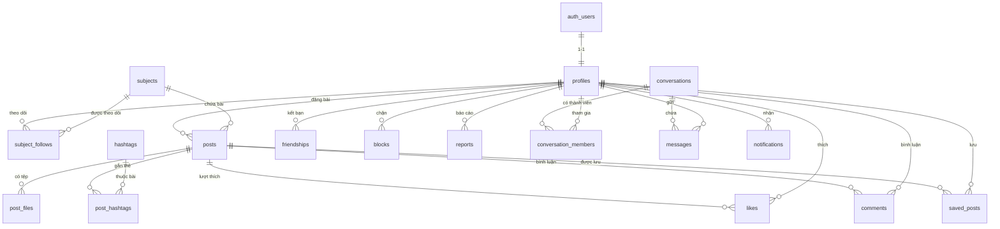

# 🎓 StudyHub - Mạng Xã Hội Học Tập Trên Nền Tảng Di Động

**StudyHub** là ứng dụng mạng xã hội học tập dành riêng cho học sinh, sinh viên trên nền tảng Android. Ứng dụng giúp người dùng kết nối bạn bè, theo dõi các môn học, chia sẻ tài liệu/bài viết, hỏi đáp kiến thức và thảo luận nhóm trực tiếp theo thời gian thực (Realtime).

---

## 🛠️ Công Nghệ Sử Dụng

| Thành phần | Công nghệ / Thư viện | Mô tả |
| :--- | :--- | :--- |
| **Nền tảng** | Android (Kotlin) | Kiến trúc Multi-module (`:app-user`, `:app-admin`, `:backend`). |
| **Giao diện (UI)** | ViewBinding (XML) & Jetpack Compose | Kết hợp linh hoạt ViewBinding XML và Jetpack Compose. |
| **Backend & SDK** | Supabase (`supabase-kt` BOM) | Kotlin SDK chính thức cho Supabase. |
| **Xác thực (Auth)** | Supabase Auth | Đăng ký, Đăng nhập (Email/Password), Quản lý phiên & Khôi phục mật khẩu. |
| **Cơ sở dữ liệu** | Supabase Database (PostgreSQL) | 17 bảng dữ liệu, cấu hình Row Level Security (RLS) để phân quyền dữ liệu & Admin. |
| **Lưu trữ tệp** | Supabase Storage | Lưu trữ Avatar, Ảnh bài viết, Tệp tài liệu (PDF, DOCX...) & Media chat (`avatars`, `post-images`, `documents`, `chat-media`). |
| **Thời gian thực** | Supabase Realtime | Tin nhắn tức thì, Thông báo In-app, Trạng thái online/đang nhập (Presence). |
| **Xử lý bất đồng bộ** | Kotlin Coroutines & Flow | Quản lý luồng dữ liệu bất đồng bộ & StateFlow cho UI State. |

---

## 📌 Quy Ước & Thiết Kế Kiến Trúc Cốt Lõi

* **Cấu trúc Multi-module:**
  * `:app-user`: Ứng dụng dành cho người dùng học sinh / sinh viên.
  * `:app-admin`: Phân hệ dành riêng cho Admin quản trị hệ thống.
  * `:backend`: Module chứa `SupabaseClient`, Model, Repository & Data Source dùng chung.
* **Mức ưu tiên tính năng (WBS):**
  * **P1 (MVP - Bắt buộc):** 25 chức năng cốt lõi (Đăng ký/Đăng nhập, Hồ sơ, Môn học, Bài viết/Tài liệu, Bảng tin, Like/Comment, Kết bạn, Tìm kiếm, Chat 1-1, Thông báo).
  * **P2 (Nên có):** 23 chức năng nâng cao (Nhóm học tập, Quản trị Admin, Trả lời bình luận, Đánh dấu câu trả lời đúng, Lưu bài, Hashtag, Khám phá, Chặn người dùng, Dark mode).
  * **P3 (Mở rộng):** 12 chức năng bổ sung (Báo cáo nội dung, Lịch sử tìm kiếm, Họp trực tuyến Jitsi Meet, Trạng thái hoạt động Presence, Thống kê).
* **Quy ước hệ thống:**
  * **Kết bạn hai chiều:** Không dùng cơ chế Follow người dùng (Theo dõi chỉ dành cho Môn học). Chỉ bạn bè mới có thể nhắn tin 1-1 và thêm vào nhóm học tập.
  * **Bài viết 3 loại:** Tất cả nội dung (*Kiến thức*, *Hỏi đáp*, *Tài liệu*) dùng chung 1 luồng đăng bài, phân biệt qua thuộc tính `type`.
  * **Hệ thống Chat tái sử dụng:** Chat 1-1 và Chat nhóm dùng chung cấu trúc bảng `conversations`, `conversation_members`, và `messages`.
  * **Admin tích hợp:** Admin dùng chung app di động, phân quyền trực tiếp qua `profiles.role = 'admin'` và kiểm soát bằng Supabase RLS.

---

## 🗄️ Cấu Trúc Cơ Sở Dữ Liệu (17 Bảng PostgreSQL)

Hệ thống bao gồm 17 bảng dữ liệu được chuẩn hóa và quản lý bằng Supabase RLS:

| STT | Tên bảng | Phân hệ WBS | Mô tả chức năng |
| :---: | :--- | :--- | :--- |
| 1 | `profiles` | 1, 2, 12 | Thông tin người dùng (liên kết `auth.users`), chứa `role` (user/admin) & `is_banned`. |
| 2 | `subjects` | 3, 12.3 | Danh sách môn học (do Admin quản lý). |
| 3 | `subject_follows` | 3.2 | Người dùng theo dõi môn học. |
| 4 | `posts` | 4, 6.5 | Bài viết (loại bài: `knowledge`, `question`, `document`), chứa `best_comment_id`. |
| 5 | `post_files` | 4.1, 4.2 | Tệp hình ảnh hoặc tài liệu đính kèm bài viết. |
| 6 | `hashtags` | 4.7 | Thẻ hashtag bài viết. |
| 7 | `post_hashtags` | 4.7 | Bảng trung gian n-n giữa Bài viết và Hashtags. |
| 8 | `likes` | 6.1, 6.4 | Lượt thích bài viết. |
| 9 | `comments` | 6.2, 6.3, 6.5 | Bình luận bài viết, hỗ trợ `parent_id` (1 cấp) & `is_best_answer`. |
| 10 | `saved_posts` | 4.6 | Bài viết người dùng đã lưu. |
| 11 | `friendships` | 7.1, 7.2 | Quan hệ kết bạn (`pending` / `accepted`). |
| 12 | `blocks` | 7.6 | Danh sách người dùng bị chặn. |
| 13 | `reports` | 6.7, 12.4 | Báo cáo vi phạm (bài viết, bình luận, người dùng). |
| 14 | `conversations` | 8, 9 | Cuộc trò chuyện (`direct` / `group`). |
| 15 | `conversation_members` | 8, 9.2, 9.4 | Thành viên trò chuyện (`admin` / `member`) & `last_read_at`. |
| 16 | `messages` | 8.2, 8.5, 9.3 | Tin nhắn (`text`, `image`, `file`) & trạng thái (`sending`, `sent`, `seen`). |
| 17 | `notifications` | 10 | Thông báo In-app (like, comment, friend request, best answer...). |

### 📊 Sơ đồ thực thể liên kết (ERD)



---

## 🗺️ Phân Giải Chức Năng Chi Tiết (WBS - 60 Nhóm Chức Năng / 12 Phân Hệ)

### 1. Xác thực & Tài khoản (Authentication)
* **1.1 Đăng ký (`P1`):** Nhập Email, Mật khẩu (≥8 ký tự), Tên hiển thị; kiểm tra định dạng/mật khẩu khớp; tự động tạo `profiles`.
* **1.2 Đăng nhập (`P1`):** Đăng nhập bằng Email/Password, lưu phiên tự động đăng nhập, hiển thị lỗi (sai tài khoản, bị khóa `is_banned`, mất mạng).
* **1.3 Quên mật khẩu (`P1`):** Nhập Email nhận mã/link khôi phục, đặt lại mật khẩu mới.
* **1.4 Đăng xuất (`P1`):** Hộp thoại xác nhận, xóa session đăng nhập, chuyển về màn hình Đăng nhập (nút đặt trong Cài đặt).

### 2. Hồ sơ người dùng (User Profile)
* **2.1 Xem trang cá nhân (`P1`):** Hiển thị Avatar, Tên hiển thị, Username, Bio, số Bài viết, số Bạn bè; Tab Bài viết đã đăng & Tài liệu đã chia sẻ.
* **2.2 Chỉnh sửa hồ sơ (`P1`):** Đổi/Xóa Avatar (Supabase Storage), đổi Tên hiển thị, Username (kiểm tra trùng), Bio.
* **2.3 Xem hồ sơ người dùng khác (`P1`):** Xem thông tin công khai, nút trạng thái quan hệ (Kết bạn/Hủy/Chấp nhận/Bạn bè), nút Nhắn tin (khi đã là bạn bè), Menu Chặn/Báo cáo.

### 3. Môn học (Subjects)
* **3.1 Danh sách môn học (`P1`):** Hiển thị danh sách môn học, lọc nhanh theo tên, chọn môn để mở trang môn học.
* **3.2 Theo dõi môn học (`P1`):** Theo dõi / Bỏ theo dõi môn học, danh sách môn đang theo dõi (dùng cho Bảng tin).
* **3.3 Trang môn học (`P1`):** Tab Bài viết, Hỏi đáp, Tài liệu thuộc môn học; Nút Đăng bài nhanh với môn học được chọn sẵn.

### 4. Bài viết & Tài liệu (Posts & Documents)
* **4.1 Tạo bài viết (`P1`):** Chọn loại bài (`Knowledge` / `Question` / `Document`), chọn môn học, tiêu đề, nội dung, đính kèm tối đa 4 hình ảnh.
* **4.2 Đăng tài liệu (`P1`):** Upload file từ thiết bị (PDF, DOCX, PPTX ≤10MB) lên Supabase Storage, nhập tên & mô tả tài liệu.
* **4.3 Xem chi tiết bài viết (`P1`):** Hiển thị đầy đủ nội dung, hình ảnh, tài liệu đính kèm, tác giả, thời gian & khu vực bình luận.
* **4.4 Xem & tải tài liệu (`P1`):** Mở xem tài liệu bằng app trên máy, tải tài liệu về thiết bị.
* **4.5 Quản lý bài viết cá nhân (`P1`):** Chỉnh sửa nội dung bài viết, Xóa bài viết & file đính kèm trên Storage.
* **4.6 Lưu bài viết / tài liệu (`P2`):** Lưu / Bỏ lưu bài viết hoặc tài liệu, xem danh sách đã lưu.
* **4.7 Hashtag (`P2`):** Thêm hashtag khi đăng bài, nhấn vào hashtag để xem danh sách bài viết cùng thẻ.

### 5. Bảng tin & Khám phá (Newsfeed & Explore)
* **5.1 Bảng tin chính (`P1`):** Bài viết từ bạn bè & môn học đang theo dõi, xếp theo thời gian mới nhất, Pull to Refresh, phân trang.
* **5.2 Lọc bảng tin theo loại bài (`P2`):** Lọc theo loại bài (Tất cả / Kiến thức / Hỏi đáp / Tài liệu).
* **5.3 Khám phá (`P2`):** Bài viết nổi bật (nhiều like trong 7 ngày), môn học gợi ý, người dùng gợi ý (cùng môn học) kèm nút Kết bạn.

### 6. Tương tác nội dung (Content Interaction)
* **6.1 Thích (Like) (`P1`):** Thích / Bỏ thích bài viết, hiển thị số lượt thích.
* **6.2 Bình luận (`P1`):** Viết, Sửa, Xóa bình luận của mình; Chủ bài viết có quyền xóa bình luận trên bài của mình.
* **6.3 Trả lời bình luận (`P2`):** Trả lời bình luận (1 cấp trả lời).
* **6.4 Danh sách người đã thích (`P2`):** Xem danh sách người dùng đã thích bài viết.
* **6.5 Đánh dấu câu trả lời đúng (`P2`):** Chủ bài Hỏi đáp chọn 1 bình luận là "Câu trả lời đúng" (`is_best_answer`), bài hiển thị "Đã có lời giải".
* **6.6 Chia sẻ (`P2`):** Chia sẻ bài viết ra ứng dụng khác (Android ShareSheet), sao chép liên kết.
* **6.7 Báo cáo nội dung (`P3`):** Báo cáo bài viết, bình luận, người dùng; chọn lý do; gửi về Admin xử lý.

### 7. Kết bạn & Tìm kiếm (Friends & Search)
* **7.1 Lời mời kết bạn (`P1`):** Gửi lời mời kết bạn, Hủy lời mời đã gửi, Xem danh sách lời mời nhận được (Chấp nhận / Từ chối), Hủy kết bạn.
* **7.2 Danh sách bạn bè (`P1`):** Xem danh sách bạn bè, tìm nhanh theo tên, bấm để xem hồ sơ hoặc nhắn tin.
* **7.3 Tìm kiếm (`P1`):** Một màn hình tổng hợp với các Tab (Người dùng, Bài viết, Môn học, Tài liệu).
* **7.4 Tìm theo Hashtag (`P2`):** Thêm Tab Hashtag, gợi ý hashtag khi gõ.
* **7.5 Lịch sử tìm kiếm (`P3`):** Lưu và xóa lịch sử tìm kiếm (lưu cục bộ trên máy).
* **7.6 Chặn người dùng (`P2`):** Chặn / Bỏ chặn người dùng (tự động hủy kết bạn, ẩn bài viết, không gửi được tin nhắn), xem danh sách đã chặn.

### 8. Nhắn tin (Chat)
* **8.1 Danh sách trò chuyện (`P1`):** Hiển thị danh sách cuộc trò chuyện xếp theo tin nhắn mới nhất, xem tin nhắn cuối & thời gian.
* **8.2 Chat 1-1 (văn bản, hình ảnh) (`P1`):** Gửi/nhận tin nhắn văn bản & hình ảnh tức thì bằng Supabase Realtime, tải lịch sử phân trang (chỉ bạn bè mới nhắn tin được).
* **8.3 Trạng thái tin nhắn (`P2`):** Đang gửi / Đã gửi / Gửi thất bại (nút gửi lại) / Đã xem.
* **8.4 Tin nhắn chưa đọc (`P2`):** Hiển thị số tin chưa đọc trong danh sách trò chuyện, tự động đánh dấu đã đọc khi mở chat.
* **8.5 Gửi tài liệu trong chat (`P2`):** Gửi file tài liệu học tập trong cuộc trò chuyện.
* **8.6 Quản lý tin nhắn (`P3`):** Sao chép, trả lời, thu hồi, xóa tin nhắn phía mình.
* **8.7 Trạng thái hoạt động (`P3`):** Hiển thị Online / Offline, đang nhập tin nhắn (Supabase Realtime Presence).
* **8.8 Gửi liên kết bài viết/tài liệu (`P3`):** Chia sẻ bài viết hoặc tài liệu trực tiếp vào cuộc trò chuyện.
* **8.9 Xóa / Tìm cuộc trò chuyện (`P3`):** Xóa cuộc trò chuyện phía mình, tìm cuộc trò chuyện theo tên.

### 9. Nhóm học tập (Study Groups)
* **9.1 Tạo nhóm (`P2`):** Nhập tên nhóm, mô tả, chọn Avatar, chọn môn học liên quan (người tạo tự động là Admin nhóm).
* **9.2 Thành viên nhóm (`P2`):** Admin thêm thành viên từ danh sách bạn bè, xem danh sách thành viên, thành viên tự rời nhóm.
* **9.3 Chat nhóm (`P2`):** Nhắn tin văn bản, gửi hình ảnh, tài liệu trong nhóm, hiển thị tên/avatar người gửi.
* **9.4 Quản lý nhóm (`P2`):** Admin chỉnh sửa thông tin nhóm, xóa thành viên, xóa nhóm.
* **9.5 Họp trực tuyến (`P3`):** Tạo đường dẫn phòng họp Jitsi Meet và gửi vào nhóm.
* **9.6 Chuyển quyền admin (`P3`):** Chỉ định thành viên khác làm admin nhóm.

### 10. Thông báo (Notifications)
* **10.1 Trung tâm thông báo (`P1`):** Hiển thị danh sách thông báo kèm thời gian, chạm mở nội dung liên quan, đánh dấu đã đọc.
* **10.2 Thông báo tương tác (`P1`):** Có người thích bài viết, bình luận / trả lời bình luận, gửi lời mời kết bạn, chấp nhận kết bạn.
* **10.3 Thông báo học tập (`P2`):** Câu hỏi có trả lời được đánh dấu đúng, được thêm vào nhóm học tập, hiển thị badge chưa đọc.
* **10.4 Thông báo bài mới trong môn học (`P3`):** Có bài viết / tài liệu mới trong môn học đang theo dõi.

### 11. Cài đặt (Settings)
* **11.1 Giao diện (`P2`):** Chế độ Chủ đề Sáng / Tối (Dark Mode).
* **11.2 Tài khoản (`P2`):** Đổi mật khẩu, Đăng xuất, Xem danh sách người dùng đã chặn.
* **11.3 Quyền riêng tư (`P3`):** Ẩn / Hiện trạng thái Online với người khác.

### 12. Quản trị (Admin)
* **12.1 Phân quyền Admin (`P2`):** Tài khoản admin được đặt `role = 'admin'` trong `profiles`, hiển thị mục Quản trị trong Cài đặt, áp dụng RLS.
* **12.2 Quản lý người dùng (`P2`):** Xem danh sách người dùng, tìm kiếm theo tên/email/username, Khóa / Mở khóa tài khoản (`is_banned`).
* **12.3 Quản lý môn học (`P2`):** Xem danh sách môn học, Thêm môn học mới, Sửa thông tin môn học, Ẩn / Hiện môn học (`is_active`).
* **12.4 Xử lý nội dung bị báo cáo (`P3`):** Xem danh sách báo cáo (bài viết, bình luận, người dùng) kèm lý do, xóa bài/bình luận vi phạm, đánh dấu đã xử lý, khóa người dùng vi phạm.
* **12.5 Thống kê đơn giản (`P3`):** Hiển thị tổng số người dùng, bài viết, tài liệu, thống kê số bài viết theo từng môn học.

---

## 🚀 Kế Hoạch Lộ Trình Triển Khai (6 Giai Đoạn)

```
Giai đoạn 1 (Nền tảng)    ──► Cấu hình Supabase, Schema 17 bảng, RLS, Auth (1.1-1.4), Profile (2.1-2.3).
Giai đoạn 2 (Nội dung)     ──► Subjects (3.1-3.3), Đăng bài & Tài liệu (4.1-4.5), Kết bạn (7.1-7.2), Bảng tin (5.1).
Giai đoạn 3 (Tương tác)    ──► Like & Comment (6.1-6.2), Tìm kiếm tổng hợp (7.3), Thông báo In-app (10.1-10.2).
Giai đoạn 4 (Nhắn tin MVP) ──► Chat 1-1 Realtime (8.1-8.2), Kiểm thử toàn bộ tính năng P1 (MVP).
Giai đoạn 5 (Mở rộng P2)   ──► Nhóm học tập (9.1-9.4), Admin (12.1-12.3), Đánh dấu trả lời đúng (6.5), Lưu bài, Dark mode.
Giai đoạn 6 (Hoàn thiện)   ──► Tối ưu UI/UX, sửa lỗi, hoàn thiện P3 & Chuẩn bị Demo đồ án.
```

---

## ⚙️ Hướng Dẫn Cấu Hình Cục Bộ (`local.properties`)

Để chạy ứng dụng trên máy local, bạn cần khai báo các biến môi trường Supabase trong file `local.properties` (nằm ở thư mục gốc của dự án, **không push lên Git**):

```properties
SUPABASE_URL="https://your-project-id.supabase.co"
SUPABASE_ANON_KEY="your-supabase-anon-key-"
```
